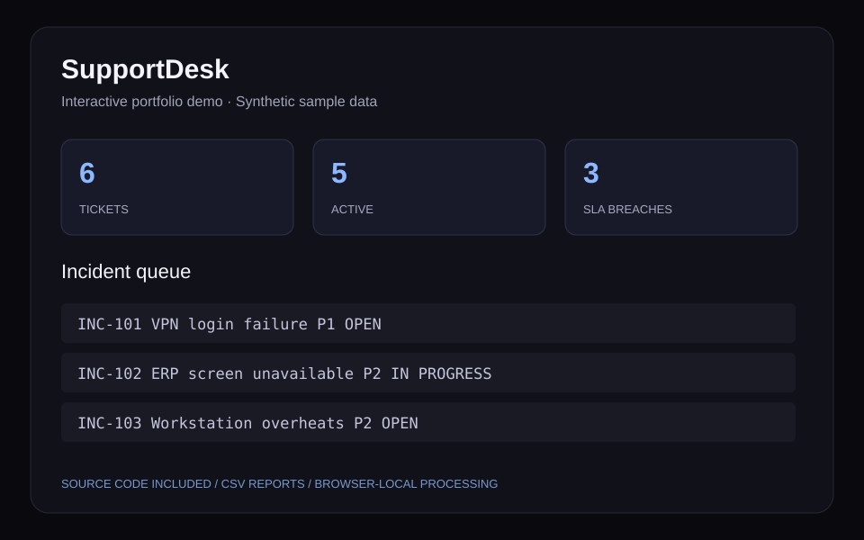

# SupportDesk — Ticket & SLA Monitor

Create and triage support tickets, track SLA risk by priority, resolve incidents, and export a queue report. Built with synthetic incidents and browser-local storage.

[](https://github.com/DEEPSXPLOIT/supportdesk-it-support/actions/workflows/ci.yml)

## Why this project

A support team needs a clear view of urgent incidents and response commitments.

A priority-based SLA rules engine calculates breaches from a fixed scenario age. Queue filters and persistent status changes support triage.

## Features

- Create incidents with a category and priority
- Filter by status and search incident descriptions
- Resolve tickets and inspect SLA risk
- Export the current queue to CSV

## Run locally

Use Node.js 22 or newer and npm. No API keys, account, or database setup is required.

```bash
git clone https://github.com/DEEPSXPLOIT/supportdesk-it-support.git
cd supportdesk-it-support
npm ci
npm run dev
```

Open http://localhost:3011. The dedicated port allows these showcase apps to run alongside the portfolio.

```bash
npm test
npm run build
```

The build produces a static site in `out/`; serve that folder with any static web host. `npm run start` serves the exported build after `npm run build`.

## A quick recruiter walkthrough

1. Resolve INC-101: active SLA breaches should drop from 3 to 2.
2. Add a new ticket and reload: it should persist locally.
3. Search the queue and export the filtered records.

## Sample records

The application starts with synthetic demo records. [View the sample register](public/sample-data.csv). Updates persist in this browser only; Reset sample restores the original demo records.

## Architecture

- `src/components/Application.js`: interactive dashboard and local state
- `src/lib/projectAnalytics.js`: independently tested CSV processing and analytics rules
- `src/data/demoData.js`: synthetic records
- `tests/`: parsing and project-specific regression checks
- `src/app/`: Next.js entry point with server-rendered styled-components setup

The implementation uses React, Next.js, styled-components, and plain JavaScript. All data processing happens in the browser. The reusable analytics module includes helpers shared across the five independently runnable projects.

## Preview illustration



This original illustration summarizes the sample interface; it is not an employer-system screenshot.

## Scope

A browser-local simulation with fixed ticket ages; no live clock, shared ticket system, authentication, or email notifications.

This is an independent portfolio project. It contains synthetic samples and no employer records. Uploaded files stay in memory; browser-local persistence is used only where the UI says so. Exported CSV cells are quoted and spreadsheet formula prefixes are neutralized.

## Author

Jaideep Mahendra · [GitHub](https://github.com/DEEPSXPLOIT) · [LinkedIn](https://linkedin.com/in/jaideep-mahendra)
